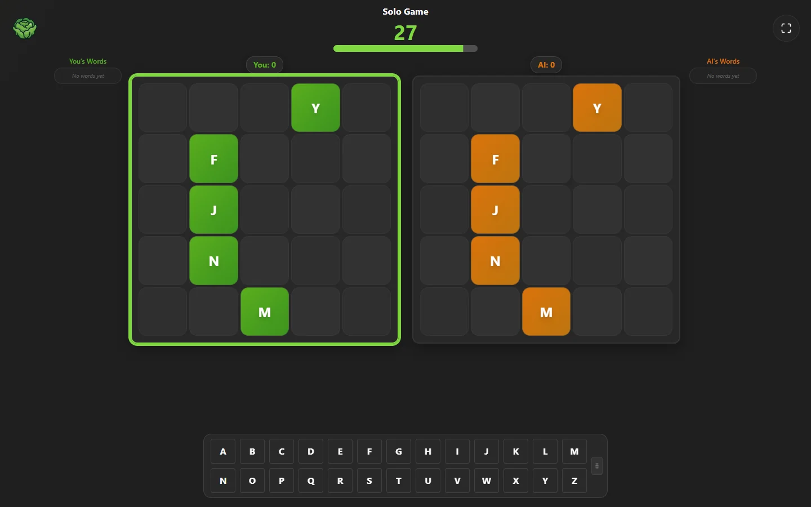
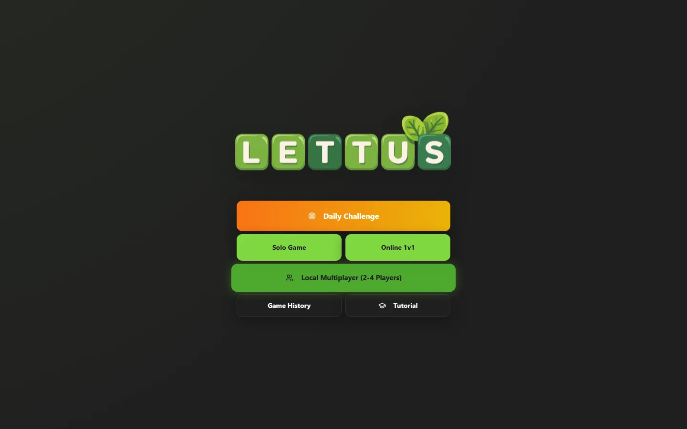
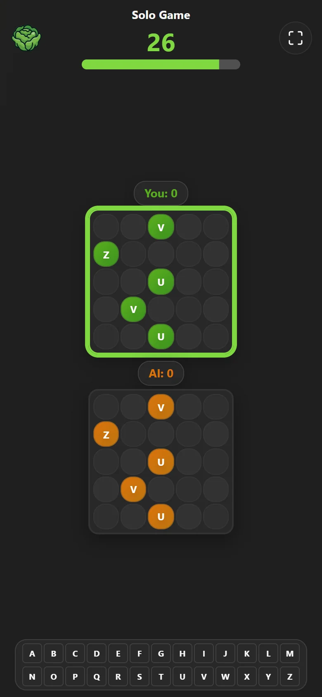

<p align="center"></p>
<p align="center"><b>A free grid word game. Build words across, down and backwards against an AI or friends on one screen.</b></p>

<p align="center">
  <a href="https://lettus.vercel.app"><b>Play Lettus</b></a>
</p>

<p align="center">
  
  
  
  
  
</p>



Lettus is a strategic word-building game. You and your opponent each build on a five-by-five grid: pick a letter, then try to make the highest-scoring words across, down and backwards. Play a solo game against the AI, take on friends on the same screen, play a friend online, or try the daily challenge.

<table>
<tr>
<td width="62%"></td>
<td width="38%"></td>
</tr>
</table>

## Modes

- **Daily Challenge:** everyone gets the same board and the same letters each day; chase Bronze, Silver, Gold and Diamond.
- **Solo Game:** play an AI on Easy, Medium or Hard.
- **Online 1v1:** play another person online.
- **Local Multiplayer:** 2 to 4 players on one screen.
- **Game History** and a seven-step **Tutorial**.

## Progression

- XP and levels for every game, with bonuses for wins, streaks and your first game of the day.
- 21 achievements, from your first word to beating the Hard AI.
- Combo popups when one letter makes several words, with sound and haptics (mute from any screen).

## Built with

Vite, React, TypeScript, shadcn/ui and Tailwind CSS, shipped as an installable PWA and deployed on Vercel.

## Run it locally

```sh
git clone https://github.com/jesaias1/word-grid-clash.git
cd word-grid-clash
npm install
npm run dev
```
